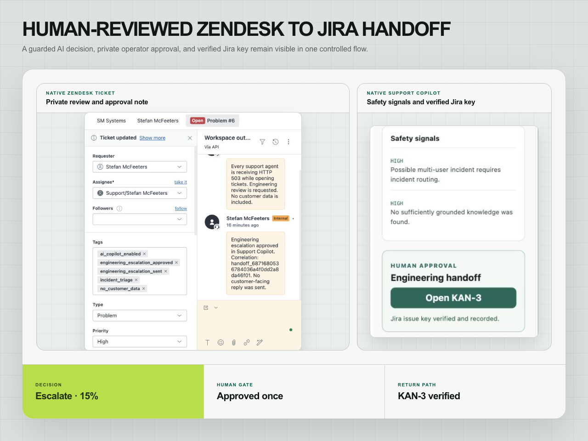

# Zendesk AI Support Copilot

A support workflow that retrieves approved knowledge, produces cited private suggestions and routes an approved engineering escalation from Zendesk to Jira. Human review remains part of every decision.

**Status:** locally runnable internal implementation with synthetic cases; the controlled AWS runtime was decommissioned on 2 August 2026.

**My contribution:** workflow design, Python/FastAPI services, retrieval and evaluation, React and Zendesk interfaces, provider integration and AWS delivery.

[Architecture](docs/architecture.md) · [Case study and results](docs/case-study.md) · [Operations](docs/operations.md)



*Controlled synthetic commissioning case, August 2026. The image combines native interface captures; it does not indicate a currently hosted service.*

## How it works

1. A ticket is matched against approved knowledge articles.
2. The application combines lexical overlap with 128-dimensional SHA256 token-feature vectors, ranked in memory. These are deterministic features, rather than learned semantic embeddings.
3. A deterministic local provider or the configured AWS Bedrock provider produces a suggestion.
4. Policy selects `draft`, `escalate` or `block`; citations, detected risks and a heuristic retrieval score remain visible.
5. A human-approved escalation writes private Zendesk context, creates one Jira task and verifies the issue-key callback.

The system has no public-reply route. Provider writes require an exact ticket allowlist and approval. PostgreSQL stores cases, decisions and audit events; pgvector persists feature vectors, while the inspected search path remains in memory. The displayed confidence is not a calibrated probability.

## Run locally

Requirements: Python 3.12, [uv](https://docs.astral.sh/uv/), Node.js 24 LTS and npm. The frontend's supported Node versions are declared in [package.json](frontend/package.json); Node 20 is not supported by its current test toolchain.

```bash
uv sync --frozen --python 3.12
npm --prefix frontend ci
npm --prefix zendesk-app ci
uv run uvicorn copilot.api.main:app --reload
```

In another terminal, run `npm --prefix frontend run dev`. Local generation is deterministic by default. Docker Compose can run PostgreSQL, the API and web app on `http://127.0.0.1:8080` with `docker compose up --build`.

## Validation

```bash
make backend
make frontend
make zendesk-app
make evaluate
make docker-config
```

The 40-case synthetic regression set checks routing, expected citations, risk flags, review gates and defined draft/redaction invariants. Citation-marker validity is not a test of every factual claim, and the unsafe-draft metric checks the route/draft invariant rather than general model safety.

The [historical commissioning results](docs/case-study.md#commissioning-result) and [metric definitions](docs/architecture.md#evaluation-contract) document the fixed-set results, provider failure and repair. They are separate from current CI and general model performance.

## Scope and current state

Public contents include application code, synthetic fixtures, tests, integration contracts and Terraform. Provider credentials, tenant configuration, private ticket allowlists, receipts and cloud state remain excluded.

The former AWS hostname is inactive. This was an internal SM Systems implementation; it does not claim customer traffic, paid-client AI delivery, model training or measured commercial savings.

## Documentation

- [Architecture and retrieval/evaluation contracts](docs/architecture.md)
- [Engineering case study, failure and repair](docs/case-study.md)
- [Security model](docs/security.md)
- [Operations and deployment state](docs/operations.md)
