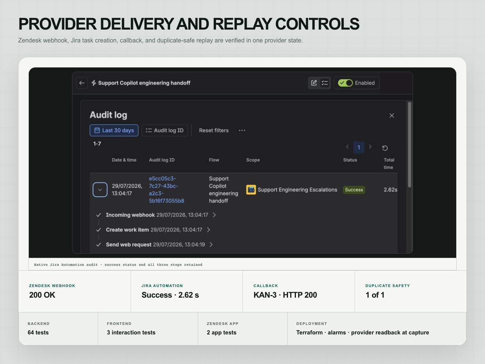

# Zendesk AI Support Copilot + Jira on AWS

A human-reviewed support system that retrieves approved knowledge, produces
cited private suggestions, applies routing and safety policy, and sends an
approved engineering escalation from Zendesk to Jira with a verified callback.


| | |
| --- | --- |
| Status | Controlled AWS commissioning completed; runtime decommissioned after closeout |
| Role | Product discovery, backend, retrieval, evaluation, frontend, provider integration and cloud delivery |
| Stack | Python, FastAPI, React, TypeScript, PostgreSQL, pgvector, AWS Bedrock, Zendesk, Jira, Terraform |
| Portfolio | [SM Systems case study](https://smsystems.au/work/zendesk-ai-support-copilot/) |

## Operating path

```text
Zendesk ticket
      |
      v
approved knowledge retrieval
      |
      v
draft, escalate or block
      |
      +-- citations and confidence
      +-- PII and payment-data checks
      +-- injection and unsupported-claim checks
      +-- review_required = true
                    |
                    v
             human decision
                    |
           approved escalation only
                    v
          Zendesk private note and tag
                    |
                    v
               Jira task
                    |
                    v
            verified callback
```

The system has no public-reply route. Suggestions remain private, every
decision requires review, and the engineering handoff is restricted to an
explicit Zendesk ticket allowlist.

## What makes the workflow safe to operate

### Human authority is structural

The native Zendesk sidebar can display a cited suggestion or prepare an
engineering escalation. It cannot send a customer-facing reply. The only
provider write requires an exact ticket allowlist and a recorded human
approval.

### Retrieval and generation stay inspectable

Approved-source retrieval, citations, model output, policy decisions and safety
signals are recorded separately. An operator can see why a case was drafted,
escalated or blocked before any provider action.

### The Jira handoff closes the loop

Zendesk invokes Jira Automation only after approval. Jira creates one task and
returns its key through a protected callback. An atomic outbound claim and
conditional state transitions prevent replay from creating a second task or a
slow dispatch from overwriting a faster callback.


## Fixed release gate

[`data/support-cases.json`](data/support-cases.json) contains 40 synthetic cases
across `draft`, `escalate` and `block` routes. The authenticated AWS evaluation
at commissioning recorded:

- 28 draft, 9 escalate and 3 block cases;
- 100% route accuracy on the fixed cases;
- 100% citation recall and risk recall;
- 0% unsafe drafts and 0% sensitive-data leaks;
- 596 ms p95 hosted latency;
- human review required on every case.

These are fixed controlled results, not customer traffic or general model
performance.


## Failure and repair

The first controlled escalation exposed two integration defects. The Jira rule
expected an existing issue in the incoming webhook body, while the Zendesk
trigger tag arrived before an exact tag readback was available. The workflow
failed closed.

The Jira trigger was corrected to accept business data without an existing work
item. The Zendesk adapter gained a bounded fallback requiring the approved tag,
a new private comment and a changed provider timestamp. A tag-only retrigger
completed the loop without adding a duplicate note or Jira task.

## Deployment architecture

The commissioned AWS path used a Cognito-authenticated Application Load
Balancer, ECS Fargate services, private encrypted RDS with pgvector, Secrets
Manager, CloudWatch and immutable container images. The native Zendesk app,
Bedrock generation and Jira callback remained inside explicit human-review and
provider-write boundaries.


## Provider delivery state

The controlled run produced one approved private Zendesk note, one Jira task
and one verified callback. The duplicate query returned exactly one matching
task. The Zendesk ticket contained two private comments and zero public
comments.



## Verification at closeout

- 64 backend tests;
- 3 operator interaction tests;
- 2 native Zendesk app tests;
- 2 healthy ECS services at capture;
- 7 CloudWatch alarms in OK state at capture;
- zero critical or high container findings at capture;
- independent final review with zero actionable findings after accepted fixes.

## Current deployment state

The controlled AWS runtime was decommissioned on 2026-08-02 after
commissioning. The public hostname is inactive. Historical logs, the Cognito
user pool and an encrypted manual recovery snapshot were retained. This
repository does not imply a currently available hosted service.

## Run locally

Requirements: Python 3.12, [`uv`](https://docs.astral.sh/uv/), Node.js and npm.

```bash
uv sync --frozen --python 3.12
npm --prefix frontend ci
npm --prefix zendesk-app ci
make backend
make frontend
make zendesk-app
make evaluate
```

Run the deterministic local API:

```bash
uv run uvicorn copilot.api.main:app --reload
```

Run the operator console in another terminal:

```bash
npm --prefix frontend run dev
```

Docker Compose starts PostgreSQL, the API and the web application on
`http://127.0.0.1:8080`:

```bash
docker compose up --build
```

## Public boundary

The committed dataset and tests are synthetic. Provider credentials, tenant
identifiers, private ticket allowlists, provider receipts and cloud state are
excluded. This is an SM Systems internal implementation, not paid-client work,
a customer deployment, autonomous public replying, general model accuracy or a
commercial outcome.

## Repository map

```text
src/copilot/     API, domain, retrieval, policy, evaluation and integrations
frontend/        operator console
zendesk-app/     private ticket-sidebar application
tests/           backend unit and integration tests
data/            40-case synthetic evaluation set
migrations/      PostgreSQL and pgvector schema
deploy/aws/      Terraform application infrastructure
assets/          public-safe application and architecture screens
docs/            architecture, security, operating notes and case study
```

- [In-depth case study](docs/case-study.md)
- [Architecture](docs/architecture.md)
- [Security model](docs/security.md)
- [Operations](docs/operations.md)
